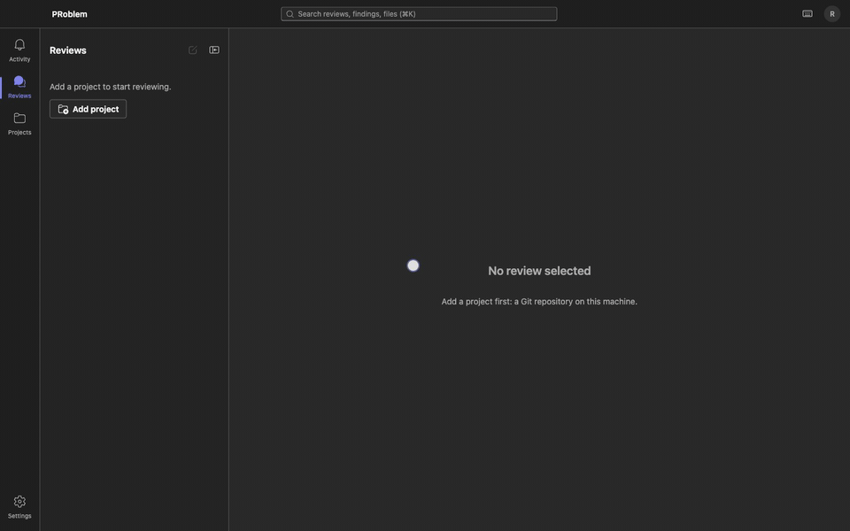
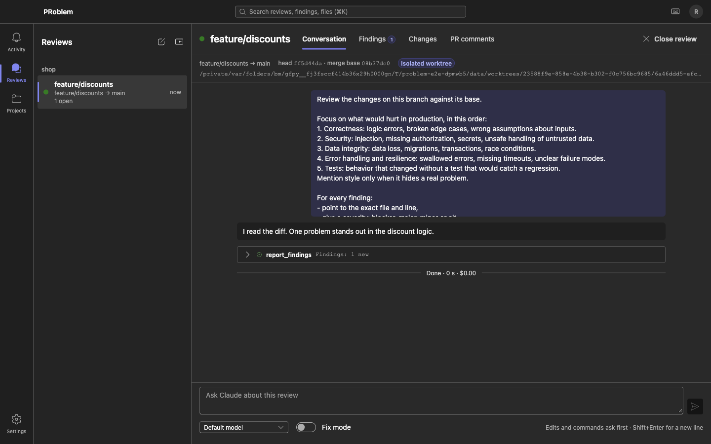
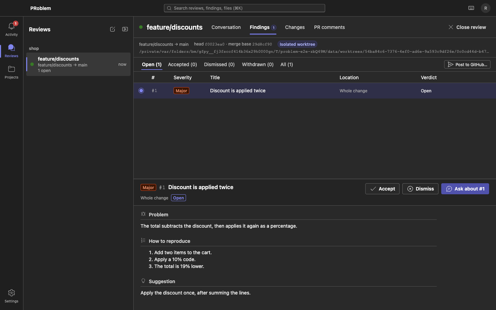
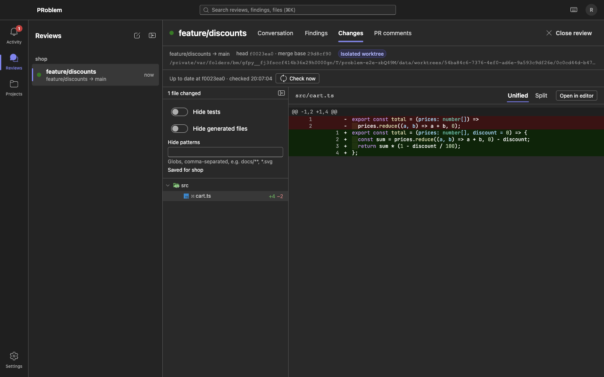
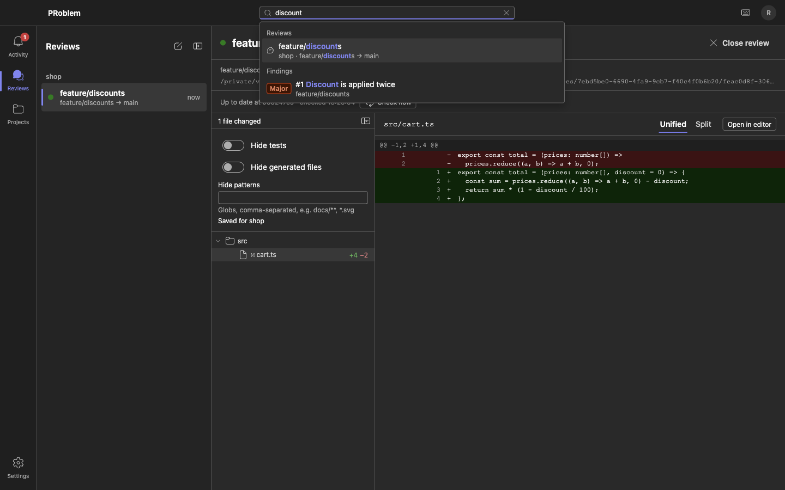

# PRoblem

**Run many AI code reviews side by side, without losing your place.**

PRoblem is a desktop app (Electron) that runs [Claude Code](https://claude.com/claude-code) reviews of git
branches and pull requests, many at once and across several repositories. Each review keeps its own
live conversation and a numbered list of findings you can triage. The UI is laid out like
Microsoft Teams, in its dark theme.

> Status: **Phases 1–8 done** (projects through polish); Phase 9 (showcase) in progress. See
> [the roadmap](docs/ROADMAP.md).



| A review: Claude's conversation and its findings | Triage a finding, with steps to reproduce it |
| --- | --- |
|  |  |
| **The change, file by file** | **Search everything (⌘K)** |
|  |  |

The screenshots come from the end-to-end test with a scripted Claude, so they show the real app.
Refresh them with `PROBLEM_SCREENSHOTS="$PWD/docs/screenshots" pnpm e2e`, and the GIF with
`pnpm --filter @problem/desktop demo:gif` (needs ffmpeg).

## Why

Reviewing several PRs at once with an AI assistant in a terminal means constant context switching:
which review was where, what was asked, which findings were already checked. PRoblem gives every
review its own room:

- **Projects and reviews**: add git repositories; start a review from a branch name or a PR link.
- **Isolated checkouts**: each review can run in its own `git worktree`, so your working tree is untouched.
- **Live conversation**: Claude's work streams into the review; ask follow-up questions or run skills.
- **Stable findings**: Claude reports findings through a dedicated tool; numbers never change, and you
  accept, dismiss or ask about each one.
- **Safe by default**: Claude is read-only; anything else asks for approval in the review.
- **Git host integration**: read PR comments and post findings to GitHub, only when you click.

## Tech stack

| Area | Choice | Why |
| --- | --- | --- |
| Shell | Electron 45 + electron-vite | Ships Node 24, so the Agent SDK and SQLite run in-process; native dialogs and window chrome ([ADR 0008](docs/adr/0008-electron-with-typed-ipc.md)) |
| Transport | Typed IPC contract (zod) | No open port; every input validated in main, every output in the UI ([ADR 0003](docs/adr/0003-shared-zod-contracts.md)) |
| Monorepo | pnpm workspaces | Desktop app + shared contract package |
| Storage | `node:sqlite` | Transactions and queries with zero native deps ([ADR 0006](docs/adr/0006-sqlite-storage.md)) |
| AI | Claude Agent SDK | Uses your local Claude Code login, skills and settings ([ADR 0004](docs/adr/0004-findings-via-mcp-tool.md), [0005](docs/adr/0005-permission-gate.md)) |
| UI | React 19, Fluent UI v9 (Teams themes) | Microsoft's own design system for a Teams look ([ADR 0001](docs/adr/0001-fluent-ui-teams-theme.md)) |
| Client state | TanStack Query + Zustand | Request cache vs. live stream state |
| Quality | Vitest, Testing Library, Playwright (Electron), Biome, TypeScript 7 strict, GitHub Actions | |
| Packaging | electron-builder | `.dmg` / NSIS / AppImage |

## Getting started

Requirements: Node 24+, pnpm 9+, git. From Phase 3 on: Claude Code installed and logged in.
From Phase 7 on: `gh` logged in for GitHub features.

```sh
pnpm install
pnpm dev
```

`pnpm dev` opens the PRoblem window with hot reload for the UI.

| Script | What it does |
| --- | --- |
| `pnpm dev` | Electron app in development (electron-vite, HMR) |
| `pnpm start` | Run the production build locally |
| `pnpm package` | Build a distributable into `apps/desktop/dist` (unsigned) |
| `pnpm verify` | Lint, type check, test, build: the definition of green |
| `pnpm test` | Vitest: main process in Node, UI in jsdom |
| `pnpm e2e` | Builds, then drives the real app with Playwright and a scripted Claude (needs a display) |
| `pnpm format` | Biome format and safe fixes |

Data lives in `~/.problem` (SQLite database, worktrees); set `PROBLEM_HOME` to use another folder.

## Project structure

```
review-room/
├── apps/
│   └── desktop/
│       ├── src/main/        Electron main: IPC dispatcher, services, SQLite, git
│       ├── src/preload/     window.problem bridge (invoke / onEvent)
│       ├── src/renderer/    React + Fluent UI, Teams-style shell
│       └── test/            main (Node) and renderer (jsdom) suites
├── packages/
│   └── shared/              zod schemas: domain, IPC contract, events
├── docs/
│   ├── ARCHITECTURE.md      how it fits together
│   ├── ROADMAP.md           the phases we build in
│   └── adr/                 architecture decision records
├── .claude/                 Claude Code setup: agents, skills, commands, hooks
└── .github/workflows/       CI
```

## Built with Claude Code

The repository includes a deliberate [Claude Code](https://code.claude.com/docs) setup, so the AI
assistant works by the same rules as a human contributor:

| Piece | Files | Purpose |
| --- | --- | --- |
| Project memory | `CLAUDE.md` | Commands, layout, conventions and hard rules loaded into every session |
| Agents | `.claude/agents/` | `architect` (plans), `code-reviewer`, `security-auditor`, `ui-reviewer` (read-only reviews), `test-engineer` (tests only) |
| Skills | `.claude/skills/` | `ship-feature` (the delivery workflow), `ipc-contract`, `fluent-teams-ui`, `agent-sdk-integration`, `write-adr` |
| Commands | `.claude/commands/` | `/phase <n>`, `/verify`, `/review`, `/adr <title>`, `/demo-prep` |
| Hooks | `.claude/hooks/` | Session start: inject the current roadmap phase. Before edits: protect lockfile, `.env`, git internals. After edits: Biome format + lint feedback |
| Permissions | `.claude/settings.json` | Allow the safe dev loop, ask for dependency changes and commits, deny secrets and `git push` |

The workflow: `/phase N` → `architect` plans → implement contract-first with tests → `/review` runs the
reviewers in parallel → `/verify` → tick the roadmap.
