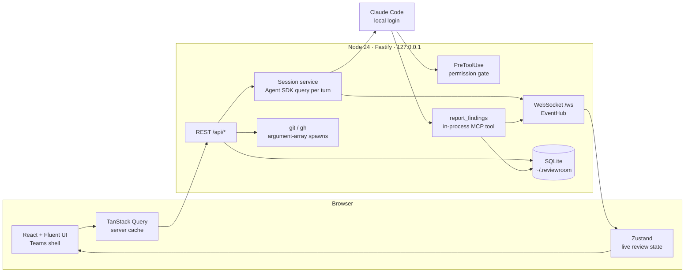

# Architecture

## Overview

Every package shares one contract: the zod schemas in `packages/shared`. HTTP bodies, WebSocket
events and Claude tool inputs are validated with them at each boundary.

## Data flow of a review turn (from Phase 3)

1. The user sends a message in a review → `POST /api/reviews/:id/messages`.
2. The session service starts `query()` in the review's workdir (`resume` after the first turn).
3. Each SDK message becomes a normalized review event, is appended to SQLite, then broadcast.
4. Tool calls go through the permission gate; when it needs the user, the review turns
   `needs-input` and an approval card appears.
5. Claude calls `report_findings`; the server assigns stable numbers, stores and broadcasts them.
6. The turn ends, the status becomes `idle`.

## Storage

`~/.reviewroom/` (override with `REVIEWROOM_HOME`):

- `reviewroom.db`: projects, reviews, events, findings, approvals (WAL mode)
- `worktrees/<project>/<review-id>/`: isolated checkouts

## Security model

Single user, local machine, but untrusted input (PR contents, any web page in the browser):

- Loopback only, origin allowlist on every request and WebSocket upgrade.
- Claude is read-only by default; the gate decides every tool call (ADR 0005).
- PR checkouts never load their own Claude settings or MCP config.
- No shell strings: every `git`/`gh` call is an argument array.
- Writing to a git host needs an explicit click per review.

## Decisions

| ADR | Decision |
| --- | --- |
| [0001](adr/0001-fluent-ui-teams-theme.md) | Fluent UI v9 with Teams themes for the UI |
| [0002](adr/0002-fastify-on-native-typescript.md) | Fastify on Node's native TypeScript, no server build |
| [0003](adr/0003-shared-zod-contracts.md) | One zod contract package shared by server and web |
| [0004](adr/0004-findings-via-mcp-tool.md) | Claude reports findings through an MCP tool |
| [0005](adr/0005-permission-gate.md) | App-owned PreToolUse permission gate |
| [0006](adr/0006-sqlite-storage.md) | `node:sqlite` for persistence |
