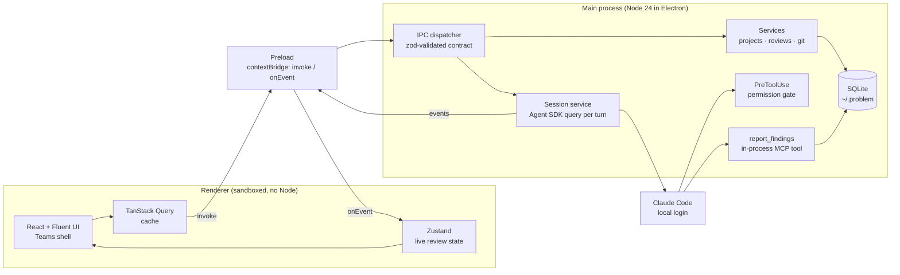

# Architecture

PRoblem is an Electron desktop app (ADR 0008). There is no HTTP server: the sandboxed UI talks
to the main process only through a typed IPC contract.

## Overview

## Code layout (`apps/desktop`)

| Path | Role | Electron? |
| --- | --- | --- |
| `src/main/index.ts` | App lifecycle, single instance, wiring | yes |
| `src/main/window.ts` | Secure `BrowserWindow`, navigation guards, hidden title bar | yes |
| `src/main/ipc/register.ts` | `ipcMain.handle` per channel, sender check, `broadcast()` | yes |
| `src/main/ipc/dispatcher.ts` | Validate input → handler → `IpcResult` | no |
| `src/main/ipc/handlers.ts` | Channel → use case | no |
| `src/main/ipc/trust.ts` | Is this URL our own UI? | no |
| `src/main/projects/`, `reviews/` | Services (use cases) and their repositories | no |
| `src/main/claude/` | Session service (Agent SDK), SDK → entry normalizer, read-only tool policy, `report_findings` MCP server | no |
| `src/main/findings/` | Findings repository, report validation, verdicts and the note to Claude (ADR 0004) | no |
| `src/main/changes/`, `git/diff.ts` | Changed files and per-file diffs between merge base and head (ADR 0013) | no |
| `src/main/activity/` | The Activity feed: rows recorded by the session, review and pull request services (ADR 0015) | no |
| `src/main/search/` | Title-bar search over open reviews, their findings and changed files (plain word matching, no index) | no |
| `src/main/pullrequests/` | PR discussion, digest for Claude, preview and posting, behind one `GitHost` per host: GitHub via `gh`, Bitbucket Cloud via its REST API (ADR 0014, 0019) | no |
| `src/main/credentials/` | Git host credentials, the token encrypted with the OS keychain (ADR 0019) | no |
| `src/main/editor/`, `settings/` | Open `file:line` in the user's editor (ADR 0011); app settings | no |
| `src/main/db/`, `git/` | SQLite + migrations; git, `gh`, GitHub and Bitbucket URL helpers | no |
| `src/main/env.ts` | Login-shell PATH for apps started from Finder | no |
| `src/preload/index.ts` | `window.problem` bridge | yes |
| `src/renderer/` | React app | no (browser APIs) |

Everything without Electron is tested in plain Node (`test/main`) or jsdom (`test/renderer`).
`e2e/` drives the built app with Playwright. `PROBLEM_E2E=1` (ignored in a packaged app) swaps in a
scripted Claude (`src/main/claude/fake.ts`) that streams a reply and reports a finding through the
app's permission hook, and keeps Electron's own data under the test's `PROBLEM_HOME`.

## The IPC contract

`packages/shared/src/ipc.ts` maps each channel (`projects:create`, `dialog:pickFolder`, ...) to a
zod input and output schema.

1. The renderer calls `api.projects.create(body)` → `window.problem.invoke("projects:create", body)`.
2. The preload forwards only channels from `IPC_CHANNELS` to `ipcRenderer.invoke`.
3. Main rejects calls from any frame that is not our UI, then the dispatcher parses the input.
   On failure it returns `{ ok: false, error: { code: "invalid_request" } }`.
4. The handler runs the use case. An `AppFailure` keeps its code (`project_exists`, ...);
   anything else is logged and reported as `internal`.
5. The renderer parses `data` with the output schema before React sees it.

Events (review status, conversation entries, live text, findings) go the other way on one
channel, validated by `AppEventSchema`.

## Data flow of a review turn (ADR 0010)

1. Creating a review sends its filled-in prompt as the first message. Later messages come from the
   composer: `invoke("reviews:send", { id, text, model })`.
2. `claude/sessions.ts` stores the user entry and marks the review `queued`. At most 3 turns
   run at once.
3. A turn starts `query()` with the user's `claude`, in the review's workdir, with `resume` after
   the first turn. The session id from `system/init` is stored on the review.
4. `claude/normalize.ts` turns each SDK message into a `ConversationEntry`. The entry is appended
   to `review_entries`, then broadcast as `review.entry`. Text deltas are broadcast as
   `review.delta` and never stored.
5. Every tool call goes through the `PreToolUse` gate (`claude/policy.ts`): allow, deny or ask.
   "Ask" goes on to `canUseTool`. It shows an approval card (`review.approval`), sets
   `needs-input` and waits for `approvals:decide`. The answer is stored as an `approval` entry
   (ADR 0012).
6. The result message becomes a `turn-end` entry (cost, duration, error). The status becomes
   `idle`, or `failed`. Stop calls `interrupt()` and kills the turn if it does not end in 10 s.
7. Claude calls `report_findings` (in-process MCP server, one per turn). Main checks the whole
   report, assigns stable numbers, saves it in one transaction and broadcasts `review.findings`.
   Verdicts the user changes go into the next message as a `[PRoblem]` note (ADR 0004).

## Storage

`~/.problem/` (override with `PROBLEM_HOME`):

- `problem.db`: projects, reviews, conversation entries, findings, the Activity feed, app
  settings; WAL mode
- `worktrees/<project>/<review-id>/`: isolated checkouts

The app was called ReviewRoom until 2026-11-18. On the first start after the rename,
`main/legacy.ts` runs these steps once:
- It moves `~/.reviewroom` (with `reviewroom.db` and its WAL files) to `~/.problem`.
- It rewrites the reviews' folders and runs `git worktree repair` for open isolated reviews.
- It moves the UI's local storage out of the old `ReviewRoom` app folder.

Pull request heads are now fetched to `refs/problem/pull/<n>`. Refs that earlier versions
fetched to `refs/reviewroom/pull/<n>` stay in the repositories until deleted.

## Security model

Single user, local machine, untrusted input (PR contents):

- Renderer: `contextIsolation`, `sandbox`, no Node, strict CSP, no navigation, no new windows.
- IPC: only contract channels; inputs validated; only our own frame may call.
- The gate decides every tool call: reading and read-only git run, everything else shows an
  approval card, and edits outside the review's folder or in `.git` are refused. Fix mode lets
  edits inside the folder run (ADR 0005, ADR 0010, ADR 0012).
- Claude sessions load only the user's settings: never a checkout's `.claude/`, `.mcp.json` or
  `CLAUDE.md` (a PR's hooks would run as shell commands).
- What Claude reports is untrusted: finding paths must stay inside the checkout. The editor gets
  only an absolute file path in a word of its own, with no shell. Presets never open the checkout
  as a workspace (ADR 0011).
- No shell strings: every `git`/`gh` call is an argument array; user input never reaches git as
  an option (ADR 0009).
- Checkouts of review code run with all git hooks disabled (ADR 0009).
- Writing to a git host needs an explicit click per review.
- The Bitbucket API token is encrypted with the OS keychain and never sent to the renderer; HTTP
  goes only to `api.bitbucket.org`, follows no redirects and checks every page link (ADR 0019).

## Decisions

| ADR | Decision |
| --- | --- |
| [0001](adr/0001-fluent-ui-teams-theme.md) | Fluent UI v9 with Teams themes for the UI |
| [0002](adr/0002-fastify-on-native-typescript.md) | ~~Fastify on Node's native TypeScript~~ (superseded by 0008) |
| [0003](adr/0003-shared-zod-contracts.md) | One zod contract package shared by main and renderer |
| [0004](adr/0004-findings-via-mcp-tool.md) | Claude reports findings through an MCP tool |
| [0005](adr/0005-permission-gate.md) | App-owned PreToolUse permission gate |
| [0006](adr/0006-sqlite-storage.md) | `node:sqlite` for persistence |
| [0007](adr/0007-project-identity-and-review-prompt.md) | A project is its repository root; its review prompt is stored as text |
| [0008](adr/0008-electron-with-typed-ipc.md) | Electron desktop app with a typed IPC contract |
| [0009](adr/0009-review-checkouts.md) | Isolated worktrees by default, detached in-place opt-in, no hooks on checkout |
| [0010](adr/0010-claude-sessions.md) | Reviews drive the user's `claude`, one query per turn, read-only until Phase 5 |
| [0014](adr/0014-github-discussion-and-posting.md) | `gh` for reading and posting; digest to Claude; preview-only posting pinned to the head |
| [0013](adr/0013-changes-view-and-refresh.md) | Own diff parser and view; check on open; Refresh moves the folder and tells Claude on the next message |
| [0012](adr/0012-approval-cards-and-fix-mode.md) | Approval cards via hook "ask" + `canUseTool`; exact grants; fix mode per review |
| [0011](adr/0011-open-in-editor.md) | Open `file:line` with an editor preset or template, split into words, no shell |
| [0015](adr/0015-activity-feed.md) | A stored Activity feed written by the services; read state per row; unread badge |
| [0016](adr/0016-allow-all-commands.md) | "Allow all commands" for one review: any Bash command, still in the sandbox; survives fix-mode edits |
| [0017](adr/0017-editable-post-text.md) | The user edits each finding's text (Write / Preview) before posting; main posts exactly that text |
| [0018](adr/0018-diff-highlighting-and-file-icons.md) | Diff highlighting with lowlight (lazy grammars, React elements), Material file icons, bundled JetBrains Mono; one file of syntax colors |
| [0019](adr/0019-bitbucket-cloud.md) | Bitbucket Cloud behind a `GitHost` interface; Atlassian API token encrypted with the keychain; comment-by-comment posting |
